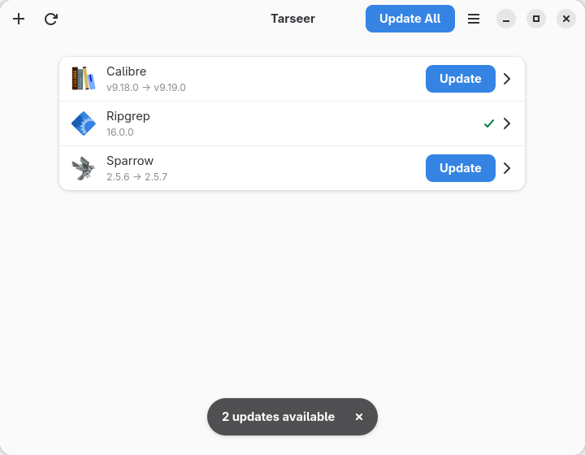

<div align="center">
  
  <h1>Tarseer</h1>
</div>

> [!WARNING]
> **This project is written entirely by AI.** All the code was generated by an
> AI coding assistant. It is reviewed and tested, but no person wrote it line
> by line. Tarseer downloads software and writes to your home folder, so
> **use it at your own risk.**

**Install and update tarball apps from GitHub Releases.**

Some Linux apps ship only as a `.tar.gz`/`.tar.xz` on their GitHub Releases
page: no Flatpak, no AppImage, no distro package. Installing them by hand means
downloading the archive, extracting it somewhere, writing a `.desktop` file so
the app shows up in the app grid, and doing it all over again for every new
version.

Tarseer does this for you. It's a GNOME app (GTK4 + libadwaita), similar to
[Gear Lever](https://github.com/mijorus/gearlever) but for tarballs.

### About the name

*Tarseer* is a play on the **tarsier**, a small primate with huge eyes, and
**seer**, someone who sees what others miss. With eyes like that, it spots new
releases of your tarballs as soon as they come out.

<p align="center">
  
</p>

> **Status:** 1.0.0. Tarseer isn't on Flathub: install the `.flatpak` bundle
> from the [Releases](https://github.com/davideb263/Tarseer/releases) page (see
> [Installing](#installing)). See [TODO.md](TODO.md) for what's planned.

## Features

- **Add an app from its repository.** Paste `owner/name` or a GitHub URL.
  Tarseer gets the latest release and picks the right tarball for your CPU
  architecture. It skips Windows/macOS builds, source archives and debug
  symbols. You can pick a different file if the guess is wrong.
- **App grid entry.** Tarseer finds the program and an icon inside the
  extracted files and writes a menu entry for it. You can change the program,
  icon and name later.
- **Updates.** *Check for Updates* (<kbd>Ctrl</kbd>+<kbd>R</kbd> /
  <kbd>F5</kbd>) asks GitHub for each app's latest release. *Update* downloads
  the release file, matched by a pattern Tarseer learned from the file you
  first picked (e.g. `calibre-7.2.0-x86_64.txz` matches next month's
  `calibre-7.3.0-x86_64.txz`).
  *Update All* updates every app one after another, and a download can be
  cancelled at any time.
- **Background checks and notifications (optional).** Turn on *Check in the
  Background* in *Preferences* and Tarseer starts without a window when you
  log in. It checks once at login, or keeps checking every 6 hours, 12 hours
  or once a day. When it finds versions you haven't heard about yet, it sends
  one notification; clicking it opens Tarseer. Repeated checks reuse GitHub's
  previous answer, so with an access token unchanged releases don't count
  against the request limit.
- **Change the release file.** If a project renames its files, moves to a new
  repository, or you want another build (e.g. musl instead of glibc), pick the
  file again from the app's details. If the app is already on the latest
  version, Tarseer offers to reinstall it with the new file right away.
- **Optional GitHub token.** Without one, GitHub allows 60 API requests per
  hour (one per app for each check). A fine-grained token with no extra
  permissions, added in *Preferences*, raises this to 5,000. It is kept in your
  keyring and only sent to the GitHub API, never with downloads.
- **Rollback.** The previous version is kept as a backup. *Restore* swaps
  back to it, and you can swap again afterwards.
- **Safe on disk.** Archives are extracted to a staging folder and moved
  into place in one step, so a failed or interrupted update leaves the
  current version alone. Archive entries that would write outside the install
  folder (absolute paths, `..`, links pointing outside, device files) are
  refused.
- **Doesn't touch other files.** Tarseer only edits or deletes menu entries it
  created itself. If a `.desktop` file with the same name already exists,
  Tarseer tells you about the conflict and doesn't overwrite it.

Supported formats: `.tar.gz`/`.tgz`, `.tar.xz`/`.txz`, `.tar.bz2`/`.tbz2`,
`.tar.zst`/`.tzst` and plain `.tar`.

## Installing

Download `Tarseer-<version>.flatpak` from the
[latest release](https://github.com/davideb263/Tarseer/releases/latest) and run:

```sh
flatpak install --user Tarseer-<version>.flatpak
```

Flatpak fetches the GNOME runtime from Flathub if you don't have it yet. The
bundle doesn't update itself: install the next release's bundle the same way.

## Where things go

| What | Location |
| --- | --- |
| Installed app | `~/.local/opt/<id>/` |
| Previous version (for rollback) | `~/.local/opt/<id>.bak/` |
| Menu entry | `~/.local/share/applications/<id>.desktop` |
| List of managed apps | `~/.var/app/io.github.davideb263.Tarseer/config/tarseer/apps.json` |
| GitHub's last answers (cache, safe to delete) | `~/.var/app/io.github.davideb263.Tarseer/cache/tarseer/releases.json` |
| Start at login (only with background checks on) | `~/.config/autostart/io.github.davideb263.Tarseer.desktop`, written by the Background portal |

The installed version is the release tag Tarseer recorded when it installed
the app. Tarseer never runs the apps it manages to find out their version.

## Known limitations

Tarseer is made for and tested on GNOME. It hasn't been tested on other
desktops yet. Based on how it is built:

- **Works on any desktop:** installing, updating and rolling back apps.
  Menu entries are standard `.desktop` files, which KDE Plasma, XFCE,
  Cinnamon, MATE and launchers like rofi or wofi all read. Some may need a
  menu refresh or a new login before a new entry shows up.
- **Looks like a GNOME app everywhere.** It uses libadwaita, so it doesn't
  follow other desktops' themes (e.g. Breeze on KDE).
- **Background checks** use the XDG Background portal. GNOME and KDE Plasma
  support it. On other setups (e.g. Sway, Hyprland), turning them on may be
  refused, and Tarseer tells you so. Even when the start-at-login entry is
  written, a window manager without XDG autostart support (or a helper like
  `dex`) won't start it.
- **Notifications** need a Notification portal backend (e.g.
  `xdg-desktop-portal-gtk`) and a notification daemon (e.g. mako, dunst) on
  desktops that don't provide them.
- **The GitHub token** is stored through the Secret Service, so it needs
  GNOME Keyring, KWallet (5.97 or later) or another Secret Service provider.
  Without one, the token can't be saved. Tarseer still works without a token,
  with GitHub's lower request limit.

## Building

Tarseer is built as a Flatpak against the GNOME 51 runtime:

```sh
flatpak install flathub org.gnome.Platform//51 org.gnome.Sdk//51
flatpak-builder --user --install --force-clean build-dir io.github.davideb263.Tarseer.json
flatpak run io.github.davideb263.Tarseer
```

The Flatpak has network access plus write access to `~/.local/opt` and
`~/.local/share/applications`, and nothing else on the host filesystem.
Notifications, starting at login, the keyring and opening links go through
XDG portals, without other D-Bus access.

Keep in mind that the apps Tarseer installs are ordinary programs, not
sandboxed: their menu entries start them outside Flatpak. That is the point
of Tarseer, but it also means writing to `~/.local/share/applications` lets
Tarseer start programs outside its sandbox. Only add repositories you trust,
as you would when installing a tarball by hand.

## Development

**Stack:** Python 3.14, PyGObject, GTK4, libadwaita 1.10, Blueprint, Meson.

```
src/tarseer/core/   logic only, no GTK: GitHub API, file picking, install, menu entries
src/tarseer/ui/     windows and dialogs (.py + .blp)
data/               .desktop, metainfo, GSettings schema, icon
tests/              unit tests for core/
tools/              dev helpers (e.g. dev_screenshot.py)
```

The code in `core/` doesn't import GTK, so the tests run on the host without
the SDK:

```sh
PYTHONPATH=src python3 -m unittest discover -s tests -t .
```

To try the app without touching your real `~/.local`, set `TARSEER_DEV_ROOT`
to a throwaway folder. Tarseer then keeps installs, menu entries and its config
inside that folder:

```sh
DEV=$HOME/tarseer-dev
mkdir -p "$DEV"
flatpak run --filesystem="$DEV" --env=TARSEER_DEV_ROOT="$DEV" io.github.davideb263.Tarseer
```

## Translations

Tarseer is available in English and Italian. Translations live in `po/`
(one `<language>.po` per language, listed in `po/LINGUAS`). To add or update
one, regenerate the template and merge it into the language file:

```sh
meson setup _build && meson compile -C _build tarseer-pot   # po/tarseer.pot
msgmerge --update po/<language>.po po/tarseer.pot
```

Use `msginit -l <language> -i po/tarseer.pot -o po/<language>.po` for a new
language. `meson compile -C _build tarseer-update-po` merges all of them at once.
To try a translation, run `flatpak run --env=LANGUAGE=it io.github.davideb263.Tarseer`.
Flatpak only installs translations for your system languages; add others with
`flatpak config --user --set extra-languages "it;de"` and reinstall.

## License

[GPL-3.0-or-later](LICENSE)
